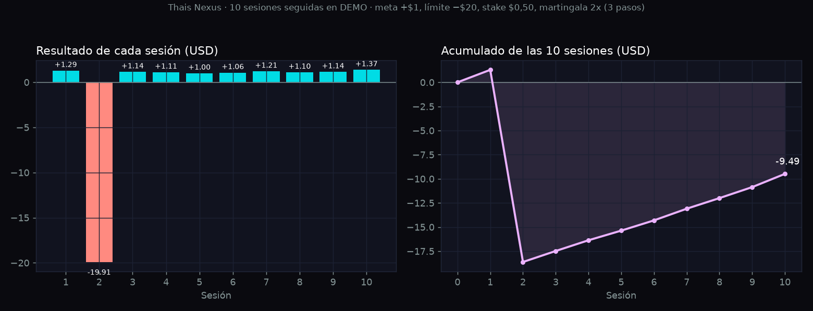

# Thais Nexus por sesiones: 10 sesiones reales en DEMO

Una forma de usar el bot es por **sesiones cortas**: le pones una meta pequeña (por ejemplo +$1) y un límite de pérdida (por ejemplo $20), lo enciendes y se detiene solo al llegar a uno de los dos. No queda operando todo el día.

Para mostrar cómo se ve en la práctica, grabamos **10 sesiones seguidas en una cuenta DEMO**, sin elegir ni repetir ninguna, y tomamos una captura al final de cada una. Abajo están todas, las buenas y la mala.

## Configuración usada

| Ajuste | Valor |
|---|---|
| Cuenta | DEMO (dinero virtual) |
| Índice | Volatility 100 (1s) |
| Contratos | Even/Odd y Rise/Fall (selección manual) |
| Stake | $0,50 |
| Martingala | 2x, máximo 3 pasos |
| Meta de la sesión (Take Profit) | +$1 |
| Límite de la sesión (Stop Loss) | −$20 |
| Trailing | apagado |

## Resultado

| Sesión | Operaciones | Duración | Resultado | Acumulado |
|---|---|---|---|---|
| 1 | 16 | 3,6 min | +$1,29 | +$1,29 |
| 2 | 37 | 5,2 min | **−$19,91** | −$18,62 |
| 3 | 4 | 1,4 min | +$1,14 | −$17,48 |
| 4 | 4 | 1,6 min | +$1,11 | −$16,37 |
| 5 | 144 | 14,6 min | +$1,00 | −$15,37 |
| 6 | 11 | 2,4 min | +$1,06 | −$14,31 |
| 7 | 3 | 1,5 min | +$1,21 | −$13,10 |
| 8 | 4 | 1,6 min | +$1,10 | −$12,00 |
| 9 | 8 | 1,8 min | +$1,14 | −$10,86 |
| 10 | 10 | 2,1 min | +$1,37 | **−$9,49** |

**9 de 10 sesiones llegaron a la meta, y aun así el total fue −$9,49.** Una sola sesión que llega al límite se lleva lo ganado en muchas sesiones buenas. El saldo de la cuenta DEMO pasó de $9160,72 a $9151,23.

La duración incluye 1 minuto de análisis al inicio de cada sesión.

## Qué esperar a largo plazo

10 sesiones son pocas. Para ver el panorama completo simulamos **20 000 sesiones** con las mismas reglas del bot (martingala, Stop Loss como tope real) y los pagos reales que cotiza Deriv:

| Configuración (meta +$1, stake $0,50, martingala 2x de 3 pasos) | Sesiones que llegan a la meta | Sesiones que tocan el límite | Resultado medio por sesión |
|---|---|---|---|
| Even/Odd, límite $20 | 84,6 % | 15,4 % | −$2,04 |
| Rise/Fall, límite $20 | 81,7 % | 18,3 % | −$2,69 |
| Even/Odd, límite $50 | 85,6 % | 14,4 % | −$6,18 |

- **La mayoría de las sesiones gana, pero el promedio pierde.** De cada 10 sesiones seguidas, solo alrededor del 18 % de los grupos termina en positivo.
- **Un límite más grande no lo arregla:** sube un poco el porcentaje de sesiones ganadoras, pero cada sesión perdedora cuesta más.
- **Elige el límite pensando en cuánto estás dispuesto a perder en una mala sesión,** no en cuánto quieres ganar.

## Las 10 capturas

Cada captura es el panel del bot al terminar la sesión: el resultado, la gráfica de la sesión, las últimas operaciones y el registro.

| | |
|---|---|
| **Sesión 1: +$1,29**  | **Sesión 2: −$19,91**  |
| **Sesión 3: +$1,14**  | **Sesión 4: +$1,11**  |
| **Sesión 5: +$1,00**  | **Sesión 6: +$1,06**  |
| **Sesión 7: +$1,21**  | **Sesión 8: +$1,10**  |
| **Sesión 9: +$1,14**  | **Sesión 10: +$1,37**  |

## Antes de usarlo con dinero real

Esto es trading y se puede perder dinero. El bot no garantiza ganancias: estas sesiones son en DEMO y los resultados pasados no aseguran los futuros. Pruébalo en DEMO todo el tiempo que necesites, usa siempre un límite de pérdida y opera solo dinero que puedas perder.

No es asesoría financiera. Thais Nexus es un proyecto independiente de Jorge Valencia · Automatizaciones y no tiene relación con Deriv.

Grabado el 13 de noviembre de 2026 con Thais Nexus v1.1.1.
