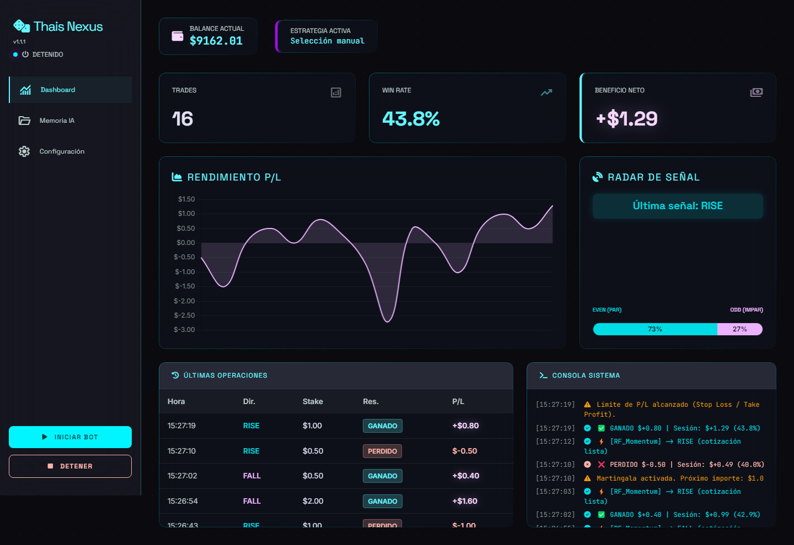
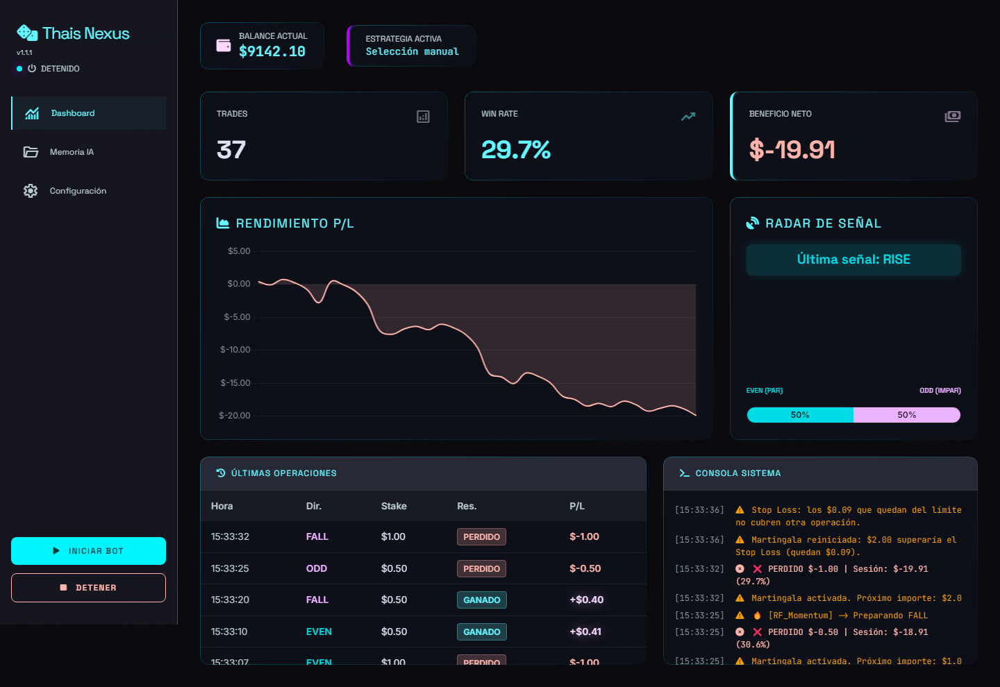
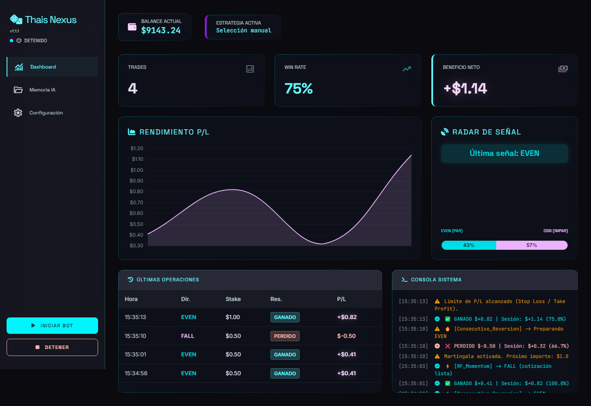
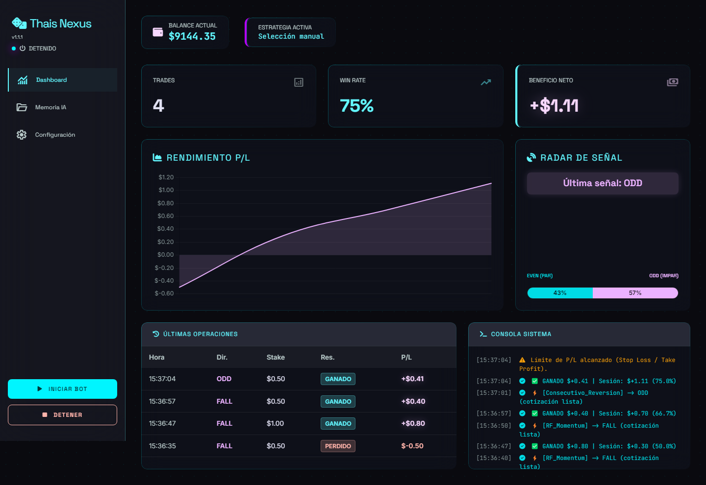
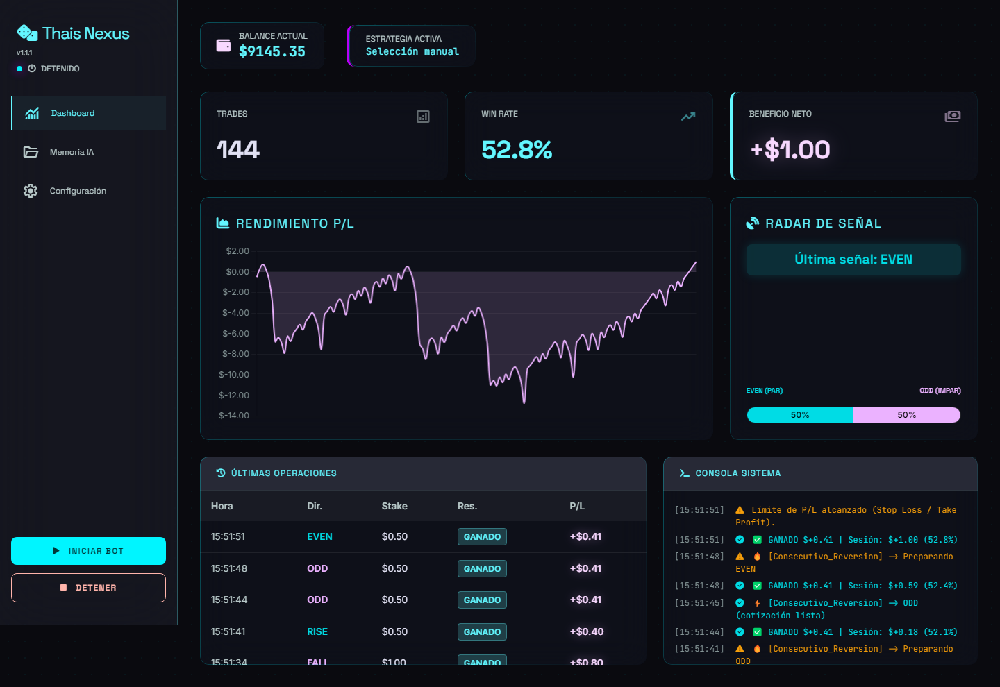
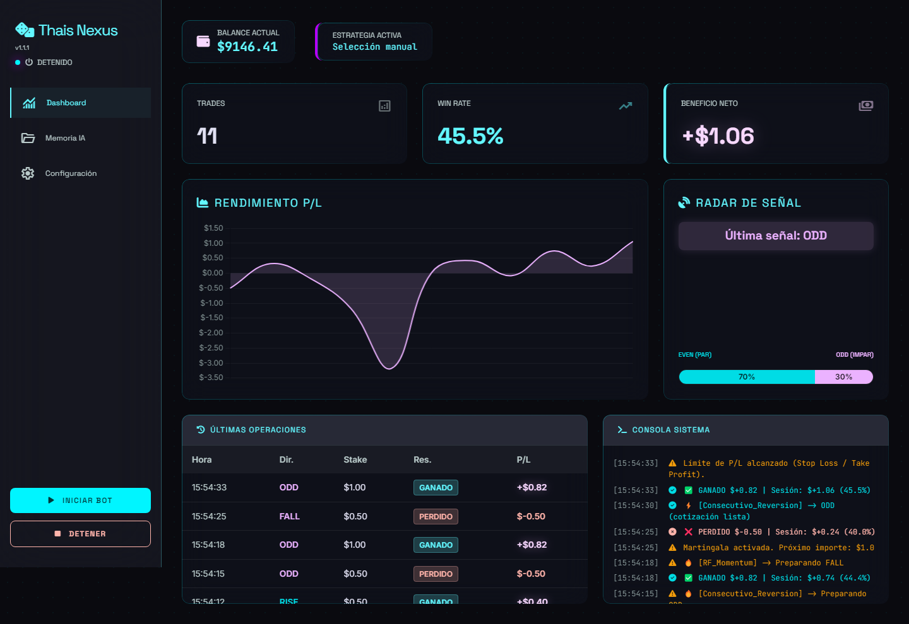
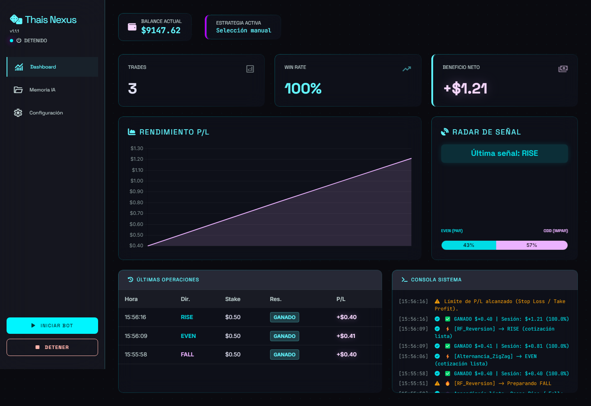
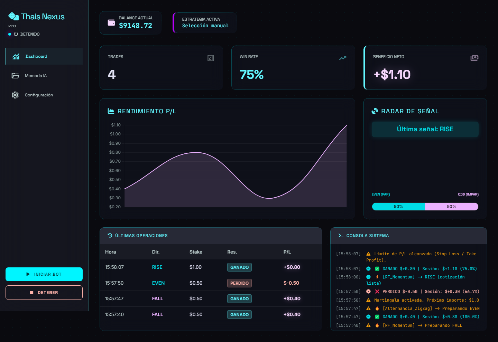
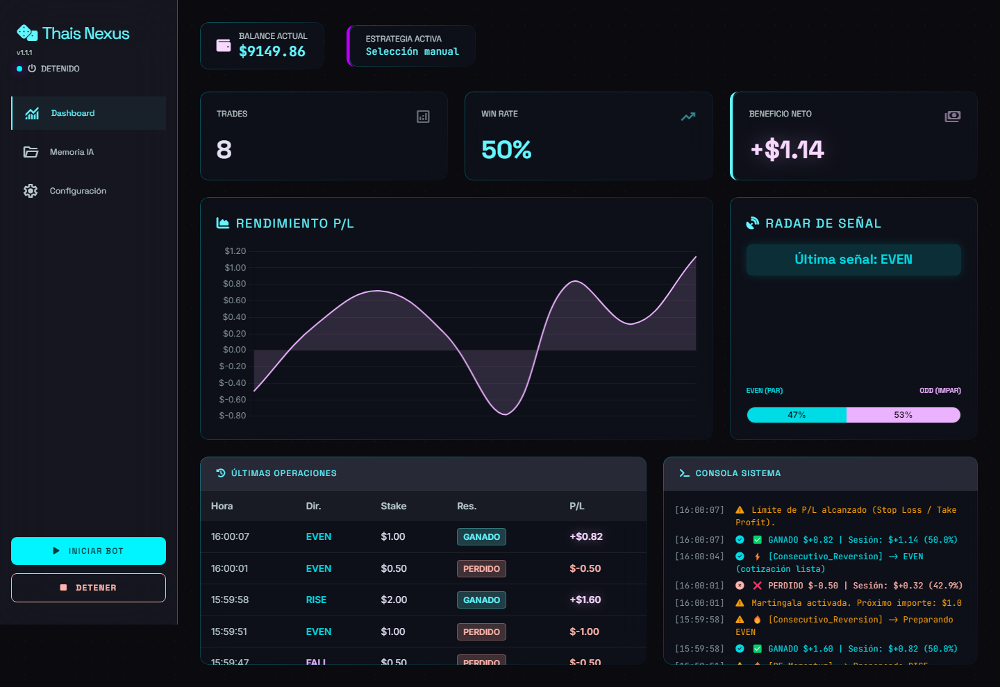
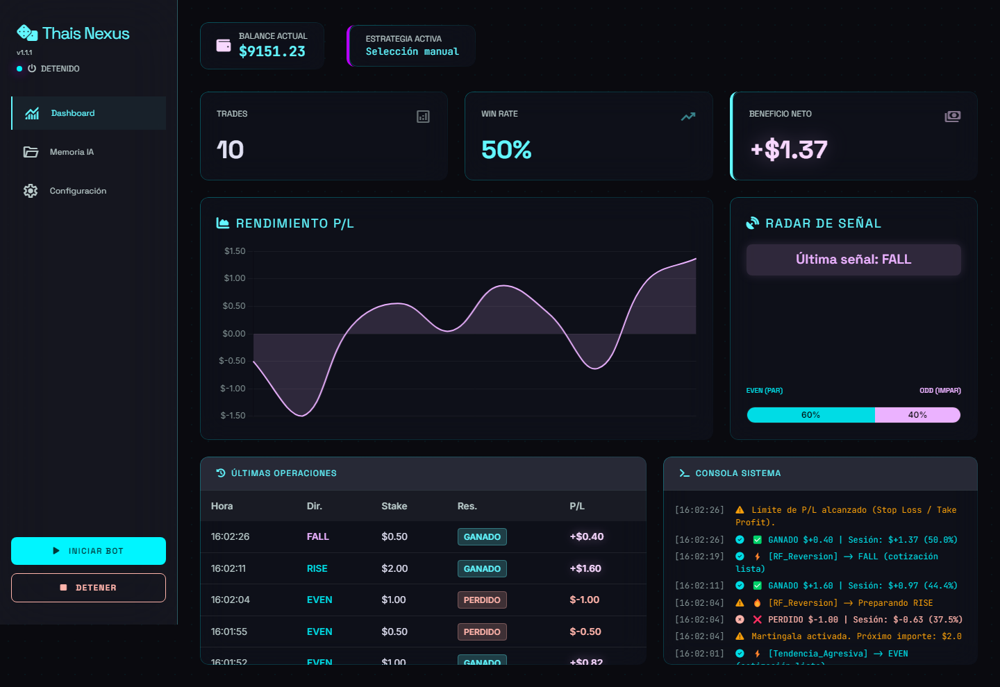

# Thais Nexus por sesiones

Thais Nexus no tiene que quedarse encendido todo el día. Lo usas por **sesiones cortas**: eliges una meta pequeña (por ejemplo +$1) y un límite de pérdida (por ejemplo $20), pulsas **Iniciar** y el bot se detiene solo al llegar a uno de los dos.

**8 de cada 10 sesiones llegan a la meta de +$1, casi siempre en pocos minutos.** Las que no llegan se detienen en el límite que tú elegiste, así que en una sesión nunca pierdes más de lo que configuraste. Elige ese límite pensando en cuánto estás dispuesto a perder en una mala sesión, no en cuánto quieres ganar.

## 10 sesiones reales, una tras otra

Grabamos 10 sesiones seguidas en una cuenta **DEMO**, sin elegir ni repetir ninguna, y tomamos una captura al terminar cada una.

| Ajuste | Valor |
|---|---|
| Índice | Volatility 100 (1s) |
| Contratos | Even/Odd y Rise/Fall |
| Stake | $0,50 |
| Martingala | 2x, máximo 3 pasos |
| Meta / límite de la sesión | +$1 / −$20 |

| Sesión | Operaciones | Duración | Resultado |
|---|---|---|---|
| 1 | 16 | 3,6 min | +$1,29 |
| 2 | 37 | 5,2 min | −$19,91 (llegó al límite) |
| 3 | 4 | 1,4 min | +$1,14 |
| 4 | 4 | 1,6 min | +$1,11 |
| 5 | 144 | 14,6 min | +$1,00 |
| 6 | 11 | 2,4 min | +$1,06 |
| 7 | 3 | 1,5 min | +$1,21 |
| 8 | 4 | 1,6 min | +$1,10 |
| 9 | 8 | 1,8 min | +$1,14 |
| 10 | 10 | 2,1 min | +$1,37 |

La duración incluye 1 minuto de análisis al inicio de cada sesión.

## Las capturas

Cada imagen es el panel del bot al terminar la sesión: el resultado, la gráfica, las últimas operaciones y el registro de lo que hizo.

| | |
|---|---|
| **Sesión 1: +$1,29**  | **Sesión 2: −$19,91**  |
| **Sesión 3: +$1,14**  | **Sesión 4: +$1,11**  |
| **Sesión 5: +$1,00**  | **Sesión 6: +$1,06**  |
| **Sesión 7: +$1,21**  | **Sesión 8: +$1,10**  |
| **Sesión 9: +$1,14**  | **Sesión 10: +$1,37**  |

## Antes de usarlo con dinero real

Esto es trading y se puede perder dinero. El bot no garantiza ganancias: estas sesiones son en DEMO y los resultados pasados no aseguran los futuros. Pruébalo en DEMO todo el tiempo que necesites, usa siempre un límite de pérdida y opera solo dinero que puedas perder.

No es asesoría financiera. Thais Nexus es un proyecto independiente de Jorge Valencia · Automatizaciones y no tiene relación con Deriv.

Grabado el 13 de noviembre de 2026 con Thais Nexus v1.1.1.
